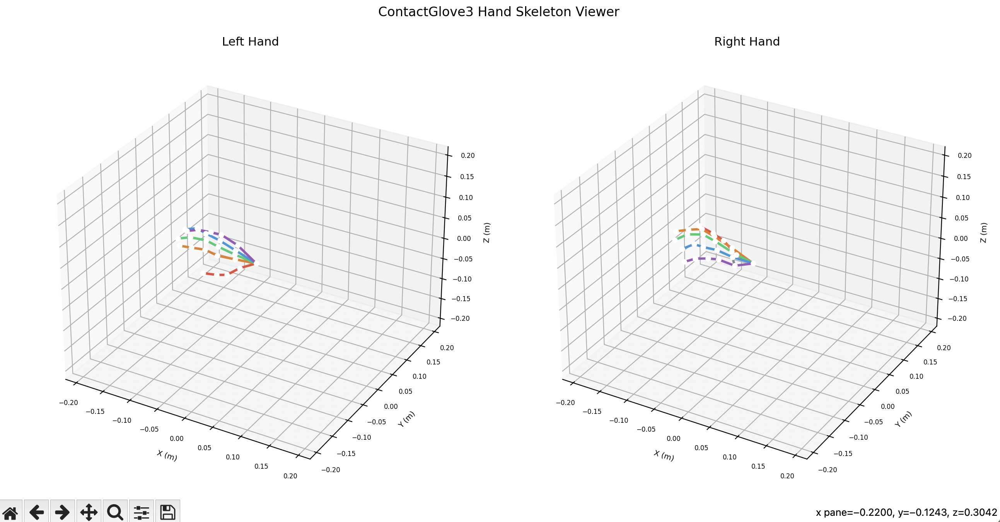
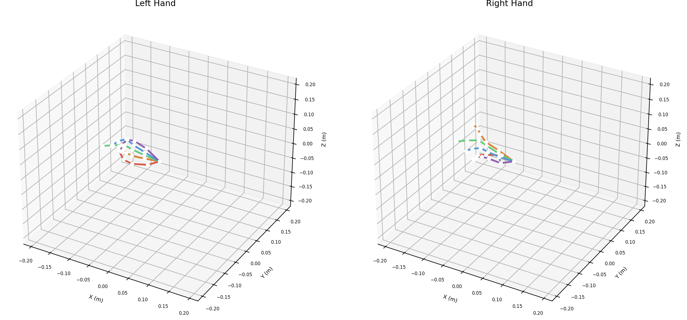

# examples/viewer

日本語 | [English](README_EN.md)

これは，contactglovesdkを用いてskeltonデータを受け取り，3Dグラフィックで描画するアプリケーションの例です．


## 使い方

DivingStationを立ち上げます．


### ビューワーの実行

ビューワーを実行します．


```sh
python3 viewer.py
```

デフォルトでは，受信した `HandSkeleton` の `is_left` に基づいて，左右それぞれ最初に見つかった1台を表示対象にします．
同じ側に複数のデバイスがある場合は，デバイスIDまたは `/DS2/HC/Device` の `name` を指定できます．

```sh
python3 viewer.py --left 99015A963645376C --right 51CF8A9510DAD8A2
python3 viewer.py --right "ContactGlove3 Right"
```

## 実行結果

### 手を開いた時の様子




### 指同士をくっつけている時の様子


