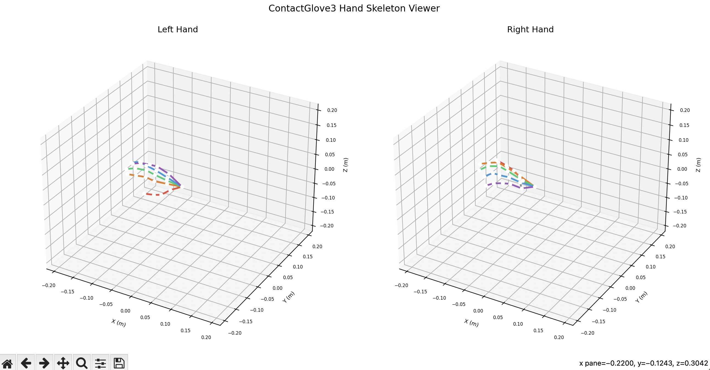
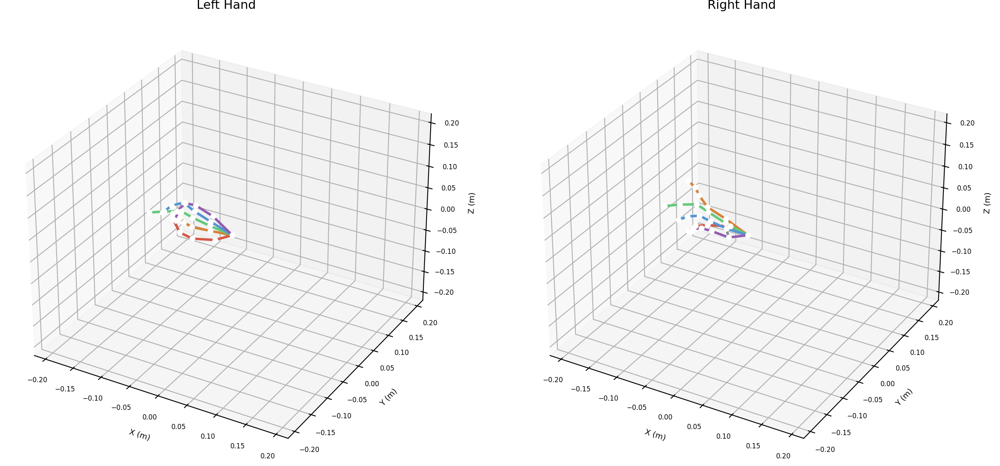

# examples/viewer

[日本語](README.md) | English

This is an example application that receives skeleton data with contactglovesdk
and draws it as 3D graphics.

## Usage

Start DivingStation.

### Running the viewer

Run the viewer.

```sh
python3 viewer.py
```

By default, based on the `is_left` field of the received `HandSkeleton`, the
first device found for each side is displayed. If you have several devices on
the same side, you can specify a device ID or the `name` in `/DS2/HC/Device`.

```sh
python3 viewer.py --left 99015A963645376C --right 51CF8A9510DAD8A2
python3 viewer.py --right "ContactGlove3 Right"
```

## Results

### Hand opened




### Fingers touching each other


